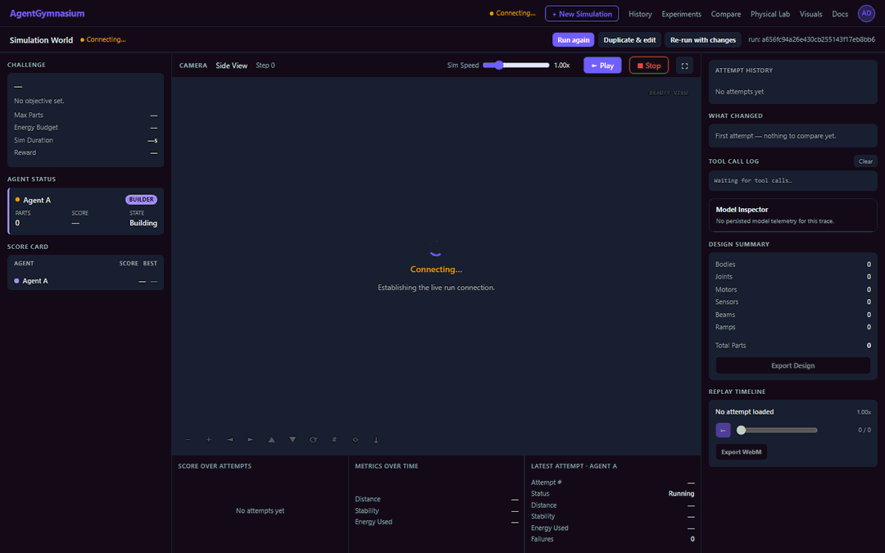

<div align="center">

# AgentGymnasium

**Watch an agent solve a physics challenge, inspect its changes, and compare results.**

[](https://github.com/oney-erge/AgentGymnasium/actions/workflows/ci.yml)
[](LICENSE)
[](pyproject.toml)



<sub>The built-in offline demo uses scripted tool calls, so it needs no API key or model.</sub>

</div>

AgentGymnasium gives an agent a world, a physics engine, and explicit tools to
build bridges, creatures, machines, and small environments. It validates each
design change, runs the simulation, records the result, and lets you replay and
compare attempts.

Try the [recorded bridge replay](https://oney-physics-replays.hazycow18.chatgpt.site/agentgymnasium.html)
in your browser. An [experimental Windows x64 preview](https://github.com/oney-erge/AgentGymnasium/releases/tag/preview-windows-2026-10-30)
contains the latest comparison changes. [Older previews](https://github.com/oney-erge/AgentGymnasium/releases/tag/preview-0.1.2-cross-platform)
are also available for Linux and macOS. These archives are unsigned and have not
been run on clean machines.

```text
Choose a challenge -> agent designs -> physics tests -> replay -> score -> next attempt
```

## Quick start

```bash
git clone https://github.com/oney-erge/AgentGymnasium.git
cd AgentGymnasium
./run.sh            # Linux; macOS: ./run.command
```

On Windows, use `.\run.bat`. The launcher installs dependencies and opens the
challenge screen at **http://localhost:8765**. Node is not needed unless you
change the frontend.

Choose a bridge or sorter case and **Run offline example**. It uses scripted
tool calls and needs neither a model nor an API key. For a real model,
connect [LocalDeploy](https://github.com/oney-erge/LocalDeploy) or another
OpenAI-compatible endpoint; see [provider setup](docs/GETTING_STARTED.md#openai-api-key).
For a repeatable, model-free comparison, run the [versioned bridge example](docs/EXPERIMENTS.md#headless-sweep).
Its mock results demonstrate the pipeline, not model intelligence.

## What you can do

- Build and replay agent attempts in the Simulation Studio, then compare up to
  four replays side by side by simulation time. Download a recorded replay as
  a standalone HTML file or export the underlying run artifacts.
- Run repeatable model, seed, and prompt experiments with recorded prompts,
  latency, token usage, configuration, benchmark fingerprints, and scores.
- Inspect a durable history of attempts, construction steps, physics traces,
  and explainable scorecards.
- Use validated tools for building, inspection, physics, and evolution.
  Invalid tool arguments are rejected before reaching the physics engine.
- Use the offline Pymunk 2D simulator or the Physical Lab boundary with a mock
  rover or configured ROS 2 gateway.

| Challenge | Goal |
|---|---|
| Bridge Builder | Carry a crate to the goal while staying stable and lean. |
| Crawl Challenge | Move a creature forward and cross the threshold. |
| Sorter | Put each ball into the bin that accepts its class. |
| Tiny City | Build a well-spaced, livable small city. |

## What to expect

AgentGymnasium is an evaluation and simulation environment, not a certified
robot safety controller. The default 2D simulation runs locally on the CPU and
does not require a GPU. A real ROS 2 gateway must independently enforce local
watchdogs, actuator limits, collision avoidance, and an emergency stop.
Model requests currently contain text and tools; the rendered replay is for the
human observer. The starter challenge pack is experimental and does not yet
provide validated reference solutions.

The standard launchers also provide `doctor`, `repair`, `docker`, `logs`,
and `stop`. Docker binds the UI to loopback and persists run data in a named
volume. See [Setup and automation](docs/GETTING_STARTED.md) for manual setup,
headless runs, experiment sweeps, and provider variables.

Existing Agentarium users retain command, environment-variable, and run-data
compatibility. The Docker volume name changed; see
[migration details](docs/GETTING_STARTED.md#launcher-and-migration-details)
before upgrading an existing installation.

## Documentation

| Guide | Use it for |
|---|---|
| [Setup and automation](docs/GETTING_STARTED.md) | Model connections, migration, and development |
| [Architecture](docs/ARCHITECTURE.md) | Components, tool boundary, providers, and invariants |
| [Experiments](docs/EXPERIMENTS.md) | Reproducible model matrices, statistics, and artifacts |
| [Embodiment](docs/EMBODIMENT.md) | Mock and ROS 2 adapters, safety state, and gateway contract |
| [Examples](docs/examples/) | Exported reports and scorecards |
| [Portable preview notes](docs/RELEASING.md) | Preview assembly and limitations |
| [Known gaps](docs/remaining_gaps.md) | Current limitations and deferred work |

Apache-2.0. Built by [Oney Erge](https://oneyerge.com).
