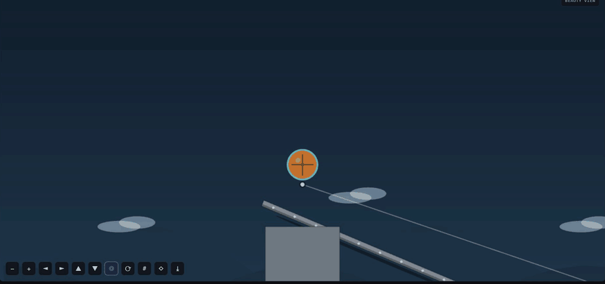

# Model experiments

AgentGymnasium evaluates models as controlled run matrices rather than as isolated
demos. Every cell is a normal persisted AgentGymnasium launch, so it keeps the
design, trace, score, tool calls, model interactions, launch config, and
provenance needed to audit or replay the result.

## Matrix

An experiment combines:

- one immutable base `LaunchConfig`;
- one or more provider/model variants;
- paired provider sampling seeds;
- one or more repeats.

The scheduler applies only the selected model variant and seed to each copied
base config. This keeps the task, world, tools, attempt budget, constraints, and
reward identical across models. The cosmetic seed defaults to 0 for experiment
cells unless explicitly set. The legacy world seed remains recorded for older
consumers; it does not generate a different physical task. The fingerprint covers
the scenario, preset, world, constraints, and tool schemas, excluding sampling and
cosmetic seeds. Fingerprints from older releases used a different definition.
The **Re-run with changes** dialog edits the first agent's model-sampling seed. It preserves
other agents' sampling and the recorded cosmetic seed, including for older saved runs that
used the world seed as a fallback. A provider may ignore a requested sampling seed.

Experiments are intentionally bounded to 120 cells and run sequentially. That
keeps local endpoints and laptops usable and avoids changing results through
uncontrolled concurrency. Cancellation takes effect after the current cell.

After a server restart, an interrupted experiment remains stopped until you
choose **Resume queued cells**. Completed cells stay intact. An in-flight cell
is marked failed and is never retried automatically because a provider request
may already have run or incurred a charge. Supply keys again for queued model
variants if required; credentials are not saved. Older records without the
in-flight checkpoint cannot be safely resumed and remain available to inspect.
The API also accepts `POST /api/experiments/{id}/resume` with an `api_keys`
object keyed by queued model variant ID; sending this request explicitly starts
the remaining cells.

## Statistics

The Experiments screen reports:

- sample count and success rate;
- mean score and sample standard deviation;
- Student-t 95% confidence interval when at least two scores are available;
- mean model latency and total tokens;
- pairwise comparisons on matching `(seed, repeat)` cells;
- paired win/tie/loss counts, mean score delta, and its 95% interval.

The interval assumes independent observations and an approximately normal mean;
repeated runs using the same seed may not be independent. For more than 30
degrees of freedom the 30-df critical value is used conservatively. No interval
is reported for fewer than two observations or pairs. Samples smaller than five
are preliminary and should be read as smoke evidence, not a definitive leaderboard.
Use several representative tasks, enough paired seeds, and repeats when model
sampling is non-deterministic. A confidence interval that includes zero does not
establish a score difference.

## Headless sweep

Try the versioned [offline bridge comparison](examples/bridge-comparison-v1.yaml)
first:

```bash
uv run agentgymnasium sweep --matrix docs/examples/bridge-comparison-v1.yaml
```

It prints each trial, per-variant aggregates, and paired comparisons as JSON.
Both variants use scripted mock tool calls: they demonstrate the pipeline and
are not evidence of real model performance. For a real comparison, copy the
file, configure the model providers and endpoints, and record the model versions
and any provider costs alongside the resulting experiment.

An offline Windows run of this exact pack completed six cells. Both scripted
variants scored 80 on seeds 7, 11, and 42, so all three paired comparisons
were ties. This is an example of the output, not a model leaderboard.

### Local models on the bridge

[`bridge-local-qwen35.yaml`](examples/bridge-local-qwen35.yaml) gives two local
models three attempts each on the standard bridge (world seed 7, four turns per
attempt). Each model ran in its own llama.cpp `llama-server` (build 11977) on a
laptop CPU, 6 threads, Q4_K_M weights, thinking off. One run per model, so this is
an example of what the evidence looks like, not a leaderboard:

| Attempt | Qwen3.5 4B | Qwen3.5 9B |
| --- | --- | --- |
| 1 | 23.7 | 16.7 |
| 2 | **80.0**: reached the goal, 1 part | 16.7 |
| 3 | 28.1 | **80.0**: reached the goal, 3 parts |

The scripted example also scores 80. Both models delivered the crate within three
attempts. The 9B's third attempt: two fixed decks across the gap, and the crate
rolls down the ramp, over them and past the flag (the decks glow with its weight):



Before the agent was told the real ground and sizes, neither model got the crate
across (best scores 24.6 for the 4B and 49.7 for the 9B). Three things in what the
agent was told were wrong for this case, and are fixed:

- The world summary said the floor was solid everywhere at y=0. It now says where
  the floor is solid and where it is open air, from the world's ground spans.
- Objects were listed by their centres only. Each now comes with its size, extent
  and top (a segment with its two ends), so a deck can be placed on the anchors.
- Every agent was told to add a movable body "or nothing will move". With a crate
  already rolling, the models added crates, a "crate mover" and loose decks, and
  pinned the crate to posts. When the world has a payload (a crate, ball or cargo
  it placed), the agent is now told to leave it free and build fixed parts, and a
  joint to the payload is refused with the reason. The crawl challenge's torso is
  the agent's own creature to extend, not a payload.

The earlier runs also showed the repair pass doubling the payload: a model that
re-declared the world's crate got a second crate named `crate_r`. A duplicate of a
part the world placed is now left rejected. On the CPU the 4B took about 70
seconds per attempt and the 9B about 3 minutes.

Create a YAML or JSON matrix:

```yaml
name: bridge-model-comparison
base_config:
  project_name: Bridge benchmark
  scenario:
    preset: bridge_builder
    objective: Carry the crate over the real gap.
    reward: bridge_transport
  world:
    template: island_cliff_small
    seed: 7
  agents:
    mode: single
    participants:
      - id: builder
        name: Builder
        provider: mock
        model: mock
  tools:
    enabled: [create_body, add_beam, add_joint, run_simulation, inspect_score]
  constraints:
    max_attempts: 3
    agent_turns_per_attempt: 3
models:
  - id: local-a
    label: Local model A
    provider: localdeploy
    model: model-a
    endpoint_url: http://127.0.0.1:8000/v1
  - id: hosted-b
    label: Hosted model B
    provider: openai_compatible
    model: model-b
    endpoint_url: https://example.invalid/v1
seeds: [7, 11, 42]
repeats: 2
```

Run it with:

```bash
uv run agentgymnasium sweep --matrix experiment.yaml
```

The CLI prints the completed record, aggregates, and paired comparisons as JSON. API keys can be
supplied at runtime, but are excluded from Pydantic serialization and redacted
from launch/experiment artifacts.

## Inspecting evidence

Use History to select two to four attempt trace ids and open Compare. Compare
aligns recorded simulation time by default, with an optional normalized-duration
mode. It warns when challenge, world, tools, or constraints differ and shows score
metrics, provider/model/seed, tokens, latency, and tool-call protocol side by
side. Studio's Model Inspector exposes each persisted prompt/result turn.
In Studio, **Pin baseline** remembers the displayed attempt in the current browser
tab. Open another attempt and choose **Compare with baseline**; Compare can play,
pause, or scrub the recordings together. The pin is tab-scoped, and the comparison
URL refers to local saved run IDs rather than sharing the run data itself.

Studio can download a standalone recorded replay or a run package. The package
omits the model interaction log by default; choose the explicit option to include
it. Other artifacts, including custom task text, configuration, and tool calls,
can also contain sensitive information, so inspect them before sharing.

## Starter physics cases

The experimental `starter-physics-v1` pack contains bridge and sorter cases at
three fixed gravity values. The home screen can run each case with the scripted
mock provider or open its configuration for a model. These are documented
physical instances, not validated reference solutions or a general leaderboard.
Each case uses one attempt, a 60-second simulation budget, and the default tools
except `set_gravity`, so the agent cannot change the case gravity through that
tool. Launch configuration and the fingerprint are saved with each run.

`GET /api/challenge-pack` lists the cases and `GET /api/challenge-pack/{case_id}`
returns the resolved starting configuration. You can save the returned JSON and
use `agentgymnasium run --config <path>`. Change only the provider/model and
provider seed for a matched comparison; modifying task, tools, or constraints
creates a different experiment even if its project name still mentions the pack.
The provider seed is a request to the endpoint, not a guarantee of repeatability.

### Establishing reference results

The mock agent contains candidate bridge and sorter designs, but a candidate is
not an established solution. To collect evidence for each case, first start the
local server, then run the following from the repository root:

```bash
mkdir -p runs/starter-reference-v1
for case in bridge_builder-light bridge_builder-standard bridge_builder-strong \
            sorter-light sorter-standard sorter-strong; do
  curl -fsS "http://127.0.0.1:8765/api/challenge-pack/$case" \
    -o "runs/starter-reference-v1/$case.json"
  uv run agentgymnasium run --config "runs/starter-reference-v1/$case.json" --seed 7 \
    > "runs/starter-reference-v1/$case-result.json"
done
```

The script requests the built-in mock provider and runs six simulations; it is
not a model evaluation. Retain each resolved configuration, run output, saved
trace, scorecard, tool calls, source revision, Python and physics-engine versions,
and benchmark fingerprint. Inspect the replay and tool errors as well as the
score. Repeat on the intended supported platforms before publishing expected
outcomes or tolerances. An unsuccessful case is evidence to investigate, not a
successful reference solution. Historical recordings made with other budgets
and configurations are not results for this pack.

Experiment records live under `runs/experiments/`; ordinary run data is indexed
in `runs/agentgymnasium.db` and stored under `runs/<trace_run_id>/`.
